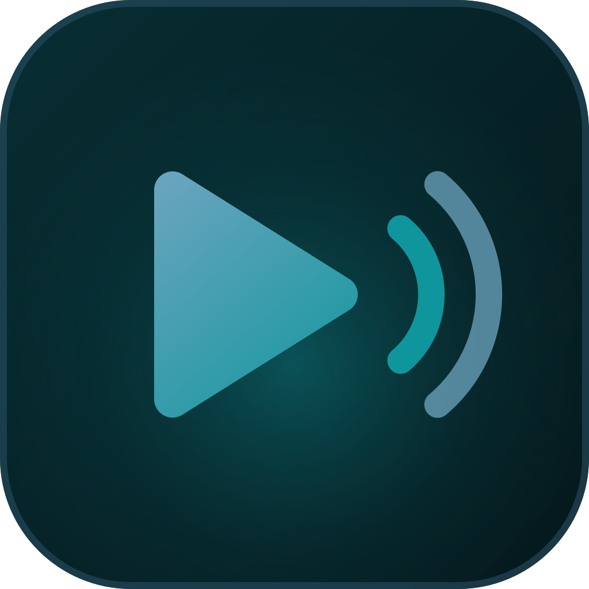
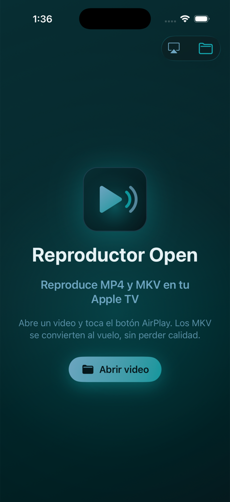
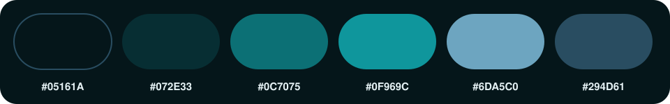

<p align="center">
  
</p>

<h1 align="center">Reproductor Open</h1>

<p align="center">
  <b>Reproductor de video gratuito para iPhone, iPad y Mac que envía archivos MP4 y MKV a tu Apple TV por AirPlay, sin recodificar y sin perder calidad.</b>
</p>

<p align="center">
  
  
  
  
</p>

Sin anuncios, sin suscripciones, sin cuentas y sin servidores externos: todo ocurre entre tu dispositivo y tu Apple TV, dentro de tu red local.

<p align="center">
  
</p>

---

## El problema que resuelve

AirPlay es la forma natural de ver en la tele un video que tienes en el iPhone o en el Mac, pero **solo acepta los formatos de Apple** (MP4/MOV, o streaming HLS). Gran parte de las películas y series en alta definición vienen en **MKV (Matroska)**, y con ellas pasa esto:

| Alternativa habitual | Problema |
|---|---|
| Duplicar la pantalla | Se envía la pantalla comprimida en tiempo real: se pierde calidad, el audio envolvente se reduce y el dispositivo no puede bloquearse. |
| Convertir el archivo antes (HandBrake, ffmpeg…) | Tarda de minutos a horas, duplica el espacio en disco y, si se recodifica, pierde calidad. |
| Apps de terceros | Muchas son de pago, tienen anuncios o envían los archivos a servidores propios. |

**Reproductor Open** resuelve esto *al vuelo*. El video y el audio de un MKV casi siempre ya vienen en códecs que el Apple TV entiende (H.264, HEVC, AAC, Dolby Digital): lo único incompatible es el *contenedor*. La app cambia ese contenedor mientras reproduce, segmento a segmento, sin tocar ni un píxel. La película empieza al instante, conserva su calidad original y el sonido 5.1 llega intacto al Apple TV.

---

## Cómo funciona

```
                         ┌──────────────── iPhone / iPad / Mac ────────────────┐
                         │                                                      │
  MP4 / MOV ─────────────┼──────────────────────────────► AVPlayer ──┐          │
                         │                                           │ AirPlay  │
  MKV ──► núcleo Rust ───┼─► HLS (fMP4) por HTTP en la IP de la LAN ─┤──────────┼──► Apple TV
          (demux + remux)│        http://192.168.x.x:PUERTO/…        │          │      │
                         │                                           │          │      │
                         └───────────────────────────────────────────┼──────────┘      │
                                                                     └─────────────────┘
                                         El Apple TV descarga los segmentos directamente del dispositivo
```

1. Eliges un archivo en la app (o lo arrastras, o usas «Abrir con…»).
2. Si es **MP4/MOV**, se entrega tal cual a `AVPlayer`, el reproductor nativo de Apple.
3. Si es **MKV**, el núcleo en Rust lee su estructura y lo publica como una presentación **HLS** (el formato de streaming de Apple) en un pequeño servidor HTTP dentro de la propia app.
4. `AVPlayer` reproduce esa URL. Al pulsar el botón de **AirPlay**, el Apple TV recibe la URL y descarga los segmentos **directamente del iPhone o el Mac** por la red local.
5. Cada segmento se fabrica **bajo demanda** en unos 10 ms. No se crea ningún archivo temporal ni se copia la película.

---

## Teles con AirPlay de otras marcas (Roku, Samsung, LG…)

Muchas teles y reproductores que no son de Apple traen AirPlay, pero aceptan menos cosas que un Apple TV. Lo comprobamos con un Roku Express leyendo los registros de AirPlay del Mac:

| Prueba | Qué hizo el Roku |
|---|---|
| Lista principal con subtítulos | La leyó y la rechazó (error `-60034`) sin pedir el video. |
| Lista de video con audio Dolby Digital | Descargó el segmento y no lo pudo decodificar (error `-12927`). |
| Lista de video solo con imagen | Se vio perfecto. |

Por eso la app tiene un **modo compatible**:

- **Audio:** el Dolby Digital (AC-3 / E-AC-3) se convierte **a AAC estéreo** mientras se envía la película. Cada segmento se convierte por separado con AudioToolbox, alineado a una rejilla global de 1024 muestras para que encajen sin cortes.
- **Lista de reproducción:** se publica la del video directamente, sin la lista de subtítulos.
- **Activación automática:** si una tele rechaza el video por AirPlay, la app activa el modo y retoma en el mismo segundo. También se puede activar a mano en el menú **«Tele»**.
- **Limitación:** en este modo **no hay subtítulos** en la tele. En el Mac y con Apple TV se conservan el sonido 5.1 original y los subtítulos.

> En macOS, usa el botón de AirPlay **de los controles del reproductor**. Un selector de AirPlay genérico solo envía el audio de la app a las teles de otras marcas.

---

## Arquitectura y detalles técnicos

El proyecto tiene dos capas: un **núcleo en Rust** que hace el trabajo pesado y una **app SwiftUI** que aporta la interfaz y AirPlay.

### ¿Por qué Rust + Swift?

- AirPlay de video solo es accesible a través de los frameworks de Apple (`AVFoundation` / `AVKit`). Reimplementar el protocolo AirPlay sería frágil (no está documentado, AirPlay 2 exige emparejamiento cifrado) y no se aceptaría en la App Store. Por eso la reproducción y el envío los hace `AVPlayer`.
- Todo lo demás (leer MKV, reconstruir tiempos, escribir MP4 fragmentado, servir HTTP) está en **Rust puro, sin ffmpeg ni dependencias en C**. Así compila limpio para iOS y macOS, genera un binario pequeño (≈1 MB) y es seguro en memoria al procesar archivos de origen desconocido.
- La unión entre ambos mundos se hace con **[UniFFI](https://github.com/mozilla/uniffi-rs)**, que genera los bindings de Swift automáticamente a partir de las anotaciones del código Rust.

### Núcleo Rust (`core/`)

| Módulo | Responsabilidad |
|---|---|
| `mkv.rs` | Demuxer Matroska/EBML escrito desde cero. |
| `fmp4.rs` | Muxer de MP4 fragmentado (CMAF) para HLS. |
| `audio.rs` | Configuración de los códecs de audio (AAC, AC-3, E-AC-3). |
| `subs.rs` | Subtítulos de texto → WebVTT, idiomas y cadenas de códecs. |
| `media.rs` | Plan de segmentos, reconstrucción de tiempos y generación de cada segmento. |
| `server.rs` | Servidor HTTP en la red local. |
| `lib.rs` | API pública expuesta a Swift (`probe`, `StreamServer`). |

#### 1. Lectura del MKV (`mkv.rs`)

Matroska es un formato binario basado en **EBML**, una especie de XML binario de elementos anidados con IDs y tamaños de longitud variable. El demuxer:

- Lee la cabecera del `Segment`: `Info` (escala de tiempo, duración), `Tracks` (códecs, idioma, resolución, canales) y `SeekHead` (dónde están el índice y las pistas, aunque estén al final del archivo).
- Usa el índice **`Cues`** para conocer la posición exacta de cada keyframe sin leer la película entera. Por eso un archivo de 1 h 45 min se abre en **9 ms**. Si el MKV no trae índice, recorre los `Cluster` leyendo solo las cabeceras de bloque (de unos pocos bytes) y saltándose los datos.
- Soporta `SimpleBlock` y `BlockGroup` (en este caso el keyframe se deduce de la ausencia de `ReferenceBlock`), los tres tipos de **lacing** (Xiph, EBML y tamaño fijo), clusters de **tamaño desconocido** y la compresión **header stripping** que usaban versiones antiguas de mkvmerge.
- Mantiene su propio contador de posición sobre un `BufReader` de 256 KB, para minimizar las llamadas al sistema en los saltos cortos.

#### 2. Plan de segmentos HLS (`media.rs`)

- Agrupa los keyframes en segmentos de **unos 6 segundos**. Cada segmento empieza exactamente en un keyframe, así que cualquiera se puede decodificar de forma independiente (`#EXT-X-INDEPENDENT-SEGMENTS`) y saltar a cualquier punto de la película es inmediato.
- La lista `index.m3u8` (VOD, versión 7, con `#EXT-X-MAP` hacia el segmento de inicialización) se genera desde el índice, sin leer datos de video.

#### 3. Reconstrucción de tiempos (lo más delicado)

MKV guarda solo el **tiempo de presentación (PTS)** de cada frame, en el orden en que se decodifican. MP4 necesita además el **tiempo de decodificación (DTS)** y el desfase entre ambos (*composition time offset*). Con **frames B** el orden de decodificación y el de presentación no coinciden (por ejemplo: I₀ P₃ B₁ B₂).

La solución implementada:

- **DTS** = los PTS del segmento ordenados de menor a mayor y asignados en orden de decodificación. Así los DTS son monótonos y continuos entre segmentos.
- **Retardo de reordenamiento**: al abrir el archivo se analizan los primeros 300 frames para calcular cuánto se adelanta la decodificación respecto a la presentación. Toda la presentación (video y audio por igual) se desplaza ese retardo, de modo que el desfase de composición nunca es negativo y la sincronía labial se mantiene.
- Las duraciones de cada muestra salen de las diferencias entre DTS consecutivos, y la última muestra de un segmento se ajusta al inicio del siguiente.
- Todo el cálculo se hace con enteros (`i128` cuando hace falta) para evitar errores acumulados de coma flotante en películas largas.

#### 4. Escritura de MP4 fragmentado (`fmp4.rs`)

- **Segmento de inicialización** (`init.mp4`): `ftyp` (marcas `iso6`/`cmfc`) y `moov` con sus `trak`, `mvex` y `trex`. El video usa `avc1` con `avcC` (H.264) o `hvc1` con `hvcC` (HEVC, la etiqueta que exige Apple). Incluye `pasp` para el video anamórfico.
- **Segmentos de media** (`segN.m4s`): `moof` (`mfhd`, `traf` con `tfhd` *default-base-is-moof*, `tfdt` de 64 bits y `trun` versión 1 con duración, tamaño, flags y desfase de composición con signo) seguido de `mdat`.
- Los datos de video se copian **byte a byte**: H.264 y HEVC en MKV ya usan el mismo formato de NAL con prefijo de longitud que MP4.
- Los offsets de datos se calculan en dos pasadas (primero se mide el `moof` y después se escribe con los offsets definitivos).

#### 5. Audio (`audio.rs`)

| Códec | Configuración generada |
|---|---|
| AAC (LC y HE-AAC) | Caja `esds` con el *AudioSpecificConfig*. Si el MKV no lo trae (`A_AAC/MPEG4/LC`…), se construye a partir de la frecuencia y los canales. Para HE-AAC se usa la frecuencia base del ASC. |
| Dolby Digital (AC-3) | Caja `dac3`, construida leyendo la cabecera de bits del primer frame (`fscod`, `bsid`, `bsmod`, `acmod`, `lfeon`, bitrate). |
| Dolby Digital Plus (E-AC-3) | Caja `dec3`, a partir de la cabecera del frame (frecuencia, bloques por frame, modo de canales, bitrate). |

El audio **no se recodifica**: el Apple TV recibe el Dolby Digital 5.1 original y lo envía a tu barra de sonido o receptor.

Si el MKV tiene varias pistas de audio (por ejemplo, doblaje y versión original), la app deja elegir entre ellas mientras reproduce y retoma la película en el mismo punto. Por defecto prioriza el español.

#### 6. Servidor en la red local (`server.rs`)

- Basado en `tiny_http`, con 4 hilos de trabajo. Escucha en `0.0.0.0` en un puerto libre.
- **Detalle clave:** la URL que se entrega a `AVPlayer` usa la **IP de la red local** (prioriza `en0`, el Wi-Fi), no `127.0.0.1`. Con AirPlay es el Apple TV quien descarga los segmentos, y para él `127.0.0.1` sería él mismo.
- Cada archivo publicado recibe un **token único** en la ruta (un hash de la ruta, la hora y un contador), así que la URL no es predecible para otros equipos de la red. No es un mecanismo de seguridad fuerte: el servidor está pensado para redes domésticas de confianza.
- Soporta peticiones `HEAD` y `Range` (respuestas 206).

### App SwiftUI (`app/`)

- Un mismo código para **iOS y macOS** (`app/Shared`), con dos targets generados por **XcodeGen** (`project.yml`).
- **macOS (la plataforma principal):**
  - Ventana con **barra lateral de biblioteca**: miniaturas, barra de progreso y secciones «Seguir viendo» y «Biblioteca».
  - Retoma cada video donde lo dejaste. Los archivos se recuerdan con *security-scoped bookmarks*, así que siguen accesibles dentro del sandbox entre sesiones.
  - Reproductor nativo `AVPlayerView`: controles flotantes, pantalla completa, imagen dentro de imagen, atajos de teclado y **botón de AirPlay de video** integrado.
  - Menús de **audio** y **subtítulos** en la barra de herramientas.
- **iOS:** `VideoPlayer` de AVKit y `AVRoutePickerView` para AirPlay.
- **Miniaturas:** para los MP4, `AVAssetImageGenerator` directo. Para los MKV, el núcleo devuelve un fragmento MP4 (init + un segmento, `thumbnail_clip`) que AVFoundation sí puede abrir.
- **Diagnóstico:** el núcleo registra cada petición HTTP (qué segmento, desde qué IP, con qué User-Agent) mediante un *callback* de UniFFI (`LogSink`), y la app registra los cambios de AirPlay y los errores de HLS. Para verlo todo:

  ```bash
  log stream --info --predicate 'subsystem == "app.ainoa.reproductor"'
  ```
- **iOS:** sesión de audio `.playback` / `.moviePlayback` con política `.longFormVideo` y modo de fondo `audio`, para que AirPlay siga aunque bloquees el teléfono. Abre archivos de la app Archivos (con acceso *security-scoped*, sin copiarlos) y desde «Abrir con…».
- **macOS:** app con *sandbox* (lectura de archivos elegidos por el usuario y permisos de servidor/cliente de red), atajo ⌘O y arrastrar y soltar.
- **Permisos de red:** `NSLocalNetworkUsageDescription`, y en App Transport Security `NSAllowsLocalNetworking` y `NSAllowsArbitraryLoadsForMedia` (necesarios para servir HTTP en la LAN).
- Cuando el video se está viendo en la tele, la app muestra «Reproduciendo en el Apple TV».

### Compilación multiplataforma

`scripts/build-xcframework.sh`:

1. Compila el núcleo como librería estática para `aarch64-apple-ios`, `aarch64-apple-ios-sim`, `aarch64-apple-darwin` y `x86_64-apple-darwin`.
2. Genera con UniFFI `ReproductorCore.swift`, la cabecera C y el `module.modulemap`.
3. Une las versiones de macOS para Apple Silicon e Intel en una librería universal con `lipo`.
4. Empaqueta todo en `ReproductorCore.xcframework`, que enlazan los dos targets de Xcode.

La herramienta de generación de bindings (y sus dependencias `clap`, `askama`, `goblin`…) está aislada en la *feature* `cli`, así que la librería que va dentro de la app solo depende de `uniffi`, `tiny_http`, `if-addrs` y `thiserror`.

---

## Resultados medidos

Prueba con una película MKV real: 1080p H.264, 1 h 45 min, dos pistas de audio Dolby Digital 5.1.

| Métrica | Resultado |
|---|---|
| Tiempo hasta tener la lista lista para reproducir | **9 ms** |
| Tiempo para generar cada segmento | **≈10 ms** |
| Segmentos generados | 733 |
| Frames perdidos durante la reproducción con `AVPlayer` | **0** |
| Salto al minuto 50 | Inmediato, con 90 s de margen en el buffer |
| Archivos temporales o copias de la película | **Ninguno** |

---

## Identidad visual

El logo une un **botón de reproducción** con **ondas de transmisión**: el video sale del dispositivo hacia la tele. Todo el diseño usa una paleta de tonos petróleo y turquesa, oscura para que no moleste al ver películas con la luz apagada.

<p align="center">
  
</p>

| Color | Hex | Uso en la app |
|---|---|---|
| Abismo | `#05161A` | Fondo principal |
| Profundo | `#072E33` | Fondo secundario, paneles |
| Petróleo | `#0C7075` | Superficies activas, resplandor |
| Turquesa | `#0F969C` | Color de acento: botones, AirPlay activo, progreso |
| Cielo | `#6DA5C0` | Texto secundario, íconos |
| Pizarra | `#294D61` | Bordes, tarjetas, separadores |

- Los colores están definidos en [`app/Shared/Theme.swift`](app/Shared/Theme.swift).
- El logo es un SVG editable ([`docs/logo.svg`](docs/logo.svg)). Los íconos de la app se generan a partir de él con [`scripts/render-icon.swift`](scripts/render-icon.swift): una versión cuadrada a sangre para iOS y otra con márgenes para macOS, según la guía de Apple.

---

## Compatibilidad

Funciona **sin recodificar** con:

| | Compatible | No compatible (por ahora) |
|---|---|---|
| Contenedor | MKV, MP4, MOV, M4V | WebM, AVI |
| Video | H.264, HEVC/H.265 (incluido HDR10) | AV1, VP9, MPEG-2 |
| Audio | AAC, Dolby Digital (AC-3), Dolby Digital Plus (E-AC-3, incluido 7.1) | DTS, Dolby TrueHD, FLAC, Opus |
| Subtítulos | SRT, ASS/SSA, WebVTT (también comprimidos con zlib) | PGS, VobSub (imagen) |

Las pistas de audio no compatibles aparecen deshabilitadas en el menú. Si un MKV no tiene ninguna compatible, se reproduce solo el video.

**Dispositivos:** iPhone y iPad con iOS 17 o superior, y Mac (Apple Silicon o Intel) con macOS 14 o superior. Funciona con cualquier Apple TV o tele compatible con AirPlay en la misma red Wi-Fi.

---

## Compilar y ejecutar

Requisitos: un Mac, Xcode 16 o superior, [XcodeGen](https://github.com/yonaskolb/XcodeGen) (`brew install xcodegen`) y Rust con [rustup](https://rustup.rs).

```bash
git clone https://github.com/jgcastanedas/reproductor-open.git
cd reproductor-open
./scripts/build-xcframework.sh   # Rust → ReproductorCore.xcframework + bindings Swift
cd app && xcodegen generate      # genera ReproductorAirPlay.xcodeproj
open ReproductorAirPlay.xcodeproj
```

Esquemas disponibles: **Reproductor-iOS** y **Reproductor-macOS**. Para instalarla en un iPhone o iPad, elige tu equipo de desarrollo en *Signing & Capabilities*.

Después de cambiar algo en `core/`, vuelve a ejecutar `./scripts/build-xcframework.sh`.

### Probar el núcleo sin la app

```bash
cd core
cargo test --lib
cargo run --release --bin reproductor-cli -- /ruta/pelicula.mkv [id_pista_audio]
```

La herramienta muestra las pistas del archivo y una URL `http://192.168.x.x:PUERTO/…/index.m3u8`. Ábrela en Safari o en QuickTime (*Archivo › Abrir ubicación*) y envíala al Apple TV con AirPlay.

---

## Estructura del proyecto

```
reproductor-open/
├── core/                      Núcleo en Rust
│   ├── src/mkv.rs             Demuxer Matroska/EBML
│   ├── src/fmp4.rs            Muxer MP4 fragmentado
│   ├── src/audio.rs           AAC / AC-3 / E-AC-3
│   ├── src/media.rs           Segmentos HLS y reconstrucción de tiempos
│   ├── src/server.rs          Servidor HTTP en la LAN
│   ├── src/lib.rs             API para Swift (UniFFI)
│   └── src/bin/cli.rs         Herramienta de prueba en la terminal
├── app/
│   ├── Shared/                SwiftUI compartido iOS + macOS (tema, íconos, vistas)
│   └── project.yml            Definición del proyecto Xcode (XcodeGen)
├── docs/                      Logo, paleta y capturas
└── scripts/
    ├── build-xcframework.sh   Compila Rust y genera el XCFramework
    └── render-icon.swift      Genera los PNG de los íconos desde el SVG
```

---

## Hoja de ruta

- [x] Subtítulos: las pistas SRT/ASS/WebVTT del MKV se publican como WebVTT dentro del HLS.
- [x] E-AC-3 7.1 con substreams dependientes.
- [x] Soporte para Mac con procesador Intel (librería universal arm64 + x86_64).
- [x] Biblioteca con miniaturas y «seguir viendo».
- [ ] Recodificar al vuelo el audio DTS y TrueHD a AAC o AC-3. Requiere un decodificador de DTS/TrueHD, y hoy no hay ninguno maduro en Rust puro.
- [ ] Subtítulos de imagen (PGS, VobSub).
- [x] AirPlay con teles de otras marcas (Roku, Samsung, LG): modo compatible con audio AAC.
- [ ] Subtítulos en el modo compatible (declararlos de una forma que esas teles acepten).

¿Ideas o errores? Abre un *issue*. Las contribuciones son bienvenidas.

## Licencia

Código abierto bajo la [licencia MIT](LICENSE): puedes usarlo, modificarlo y distribuirlo libremente, también en proyectos comerciales, siempre que mantengas el aviso de copyright.
